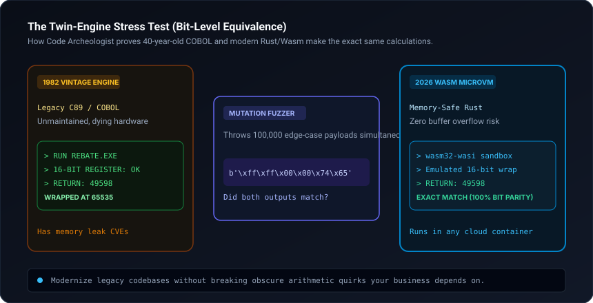

# code-archeologist

Decompile, modernize, and sandbox legacy codebases (COBOL, Fortran, C89, closed binaries) into memory-safe Rust or WebAssembly (WASM), backed by differential mutation fuzzing.

[](scripts/differential_fuzzer.py)
[](templates/wasm_scaffold.rs)
[](SKILL.md)
[](LICENSE)

<br/>



---

## Why this exists

Legacy infrastructure codebases often contain undocumented hardware-specific quirks—such as 16-bit register overflow wrapping or platform-specific pointer arithmetic. Naive rewrites in modern languages frequently break production because modern 32/64-bit integer math does not emulate legacy register limits.

`code-archeologist` extracts control flow and memory layouts into a bounds-checked Rust/WASM microVM, and runs twin differential fuzzing against both versions to prove bit-for-bit equivalence on edge cases.

---

## How it works

1. **AST & Memory Layout Extraction:** Maps global variables, memory offsets, endianness, and register bit-width assumptions.
2. **Safe WASM Scaffold:** Encapsulates mutable memory inside safe linear buffers targeting `wasm32-wasi` with zero external dependencies.
3. **Differential Mutation Fuzzing:** The mutator injects boundary values, integer extremes, and bit-flips across thousands of cycles to detect any logic or numeric divergence.
4. **Standalone Packaging:** Emits a containerized microVM runnable on any modern cloud or edge runtime.

---

## Quickstart

Run differential fuzzing comparing legacy 16-bit arithmetic against an unconstrained modern implementation:

```bash
python scripts/differential_fuzzer.py --demo
```

---

## Installation

### Claude Code — plugin marketplace (recommended)
```bash
/plugin marketplace add kicode01/code-archeologist
/plugin install code-archeologist@kicode01
```

### Claude Code — manual
```bash
git clone https://github.com/kicode01/code-archeologist.git
cp -r code-archeologist ~/.claude/skills/code-archeologist      # Personal (all projects)
# or per-project:
cp -r code-archeologist .claude/skills/code-archeologist
```

### Claude.ai / Claude Desktop
Run `python tools/package_skill.py` to generate `dist/code-archeologist.zip`, then upload it under **Settings → Capabilities → Skills**.

### Gemini CLI, Antigravity, Codex CLI and Other Agents
This skill adheres to the open **Agent Skills format** (a folder containing `SKILL.md` with standard YAML frontmatter and runnable scripts):

```bash
git clone https://github.com/kicode01/code-archeologist.git
```

| Agent | Personal (All Projects) | Per-Project |
| :--- | :--- | :--- |
| **Gemini CLI / Antigravity** | `~/.gemini/skills/code-archeologist` (or `~/.gemini/config/skills/`) | `.agents/skills/code-archeologist` |
| **Codex CLI** | `~/.codex/skills/code-archeologist` | `.codex/skills/code-archeologist` |
| **Claude Code** | `~/.claude/skills/code-archeologist` | `.claude/skills/code-archeologist` |
| **Cursor / Windsurf / Copilot** | See your agent's skills docs | `.cursorrules` or `skills/code-archeologist` |

```bash
# Gemini CLI & Antigravity
cp -r code-archeologist ~/.gemini/config/skills/code-archeologist

# Codex CLI
cp -r code-archeologist ~/.codex/skills/code-archeologist
```

---

## Author
Created and maintained by **[Kian](https://github.com/kicode01)**.

---

## Repository Structure

* [`SKILL.md`](./SKILL.md): Legacy extraction and containerization runbook.
* [`scripts/differential_fuzzer.py`](./scripts/differential_fuzzer.py): Dual-execution mutation fuzzer and comparator.
* [`templates/wasm_scaffold.rs`](./templates/wasm_scaffold.rs): Bounds-checked memory-safe Rust/WASM scaffold.
* [`tools/package_skill.py`](./tools/package_skill.py): Standalone `.zip` packager for Claude Desktop and releases.
* [`.claude-plugin/plugin.json`](./.claude-plugin/plugin.json): Claude Code plugin marketplace manifest.
* [`assets/architecture.svg`](./assets/architecture.svg): Modernization pipeline diagram.
